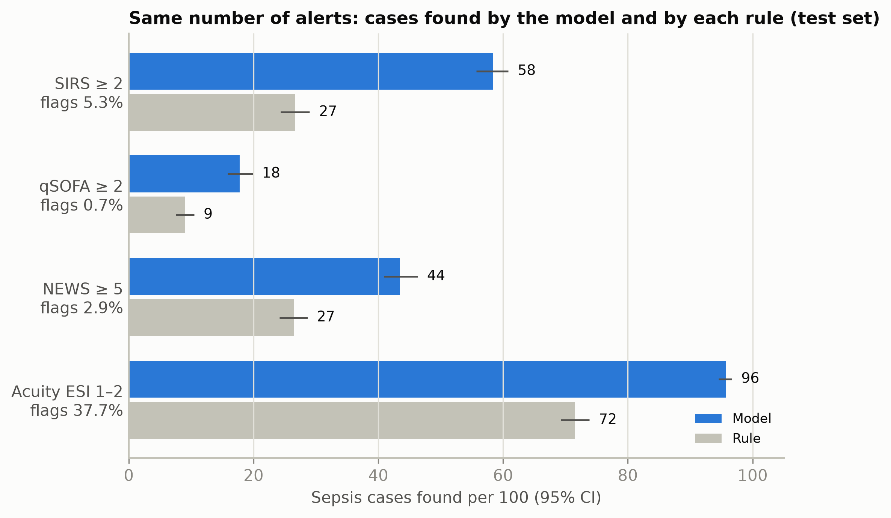

# Explainable Sepsis Risk at ED Triage

Can the information a triage nurse records in the first few minutes flag patients at risk of sepsis
better than the screening rules used today, and explain each flag?

We trained models on 409,216 adult emergency department visits from MIMIC-IV-ED, using only
triage-time information: vital signs, age, sex, the presenting complaint, how the patient arrived, and
past visits. No blood tests. The models were then tested once on patients they had never seen.

> **Research prototype, not for clinical use.**

## Results (test set: 61,690 visits, 1,508 with sepsis)

| | Sepsis cases found per 100 | Share of arrivals flagged |
|---|---|---|
| SIRS ≥ 2 (triage) | 27 | 5.3% |
| **Model, same number of alerts** | **58** (+32, 95% CI 29 to 35) | 5.3% |

- **Ranking:** AUROC 0.925 (0.919 to 0.932) and AUPRC 0.360. The best rule, NEWS, reached AUROC 0.81.
- **Equal workload:** the model found more cases than every rule: SIRS, qSOFA, NEWS and the nurse's
  acuity score.
- **Traffic light:**
  - The red tier is 5% of arrivals and holds 56% of sepsis cases (about 1 in 3.6 flagged patients has sepsis).
  - Red and amber together flag 20% of arrivals and catch 88% of cases.
- **Honest risks:** the predicted risk matched the observed rate in every tier (calibration slope 1.02).
- **Drivers:** age, shock index, arrival mode (walking in lowers risk), the number of abnormal vital signs,
  temperature, a fever complaint and a previous sepsis admission.
- **Fairness:** ranking was similar across sex, race and time period. It was weaker for patients aged
  65 and over (AUROC 0.89–0.90). Septic young adults were less often flagged high-risk.

All tables and figures are in [`results/`](results). The full findings are in
[`results/findings.md`](results/findings.md).



## How it works

1. **Cohort.** One row per adult ED visit with at least one triage vital sign.
2. **Outcome.** A sepsis diagnosis code on the visit or on the admission that followed. A secondary
   outcome is death or ICU admission within 12 hours.
3. **Features.** Only what is known at triage. Records from before this visit are used; nothing after it.
4. **Split by patient.** 70% training, 15% validation, 15% test, so no patient appears in more than one split.
5. **Models.**
   - Logistic regression, random forest and XGBoost, tuned with cross-validation on the training split.
   - Risks are calibrated on validation.
6. **Test once.** The test split is scored a single time. A lock file then blocks retraining.
7. **Explain and audit.** SHAP explanations, checked two other ways; performance by patient group.

Every analysis choice is in [`config.yaml`](config.yaml). The study protocol is in `Docs/Documents/`.

## Run it

```bash
conda env create -f environment.yml && conda activate sepsis-poster   # or: pip install -r requirements.txt
pytest tests/
```

**Without credentialed data.** Generate a synthetic dataset and run the whole pipeline. The numbers
it produces mean nothing clinically.

```bash
python tests/make_synthetic.py syn 20000
python run.py --mimic-dir syn/mimic --ed-dir syn/ed --out syn_out
python run.py --out syn_out --open-test
python app/traffic_light.py --bundle syn_out/models/bundle.joblib      # http://localhost:8050
```

**With MIMIC data.** You need your own PhysioNet credential.

1. Download seven tables into `data_real/`:
   - `mimic-iv-ed/ed/`: `edstays`, `triage`, `diagnosis`
   - `mimic-iv/hosp/`: `patients`, `admissions`, `diagnoses_icd`
   - `mimic-iv/icu/`: `icustays`
2. Run:

```bash
python run.py               # step 1: data, training and calibration (about 25 min on a laptop)
python run.py --audit       # optional: leakage checks on validation
python run.py --open-test   # step 2, once: test-set results, written to out/ and results/
python app/traffic_light.py # prototype using the trained model
```

## Repository

```
run.py              runs the pipeline
config.yaml         every analysis choice
sepsis_ed/          cohort, outcomes, features, models, evaluation, figures
app/                traffic-light prototype (offline web page)
tests/              unit tests and the synthetic data generator
results/            aggregate results from the real data (no patient-level data)
```

## Data and privacy

- Patient-level data never leaves the analysis laptop. It is never committed and never sent to online tools.
- The repository holds code and aggregate results only. Any count below 10 is shown as `<10`.
- The prototype's example patients are invented.

## Limitations

- One US hospital, analysed retrospectively.
- Sepsis was defined by diagnosis codes. These under-count sepsis and give no onset time.
- The complaint keyword groups have not yet been reviewed by a clinician.

## Future work

- A clinical sepsis definition (Sepsis-3). The code for it is in `sepsis_ed/sepsis3.py` and runs with
  `--sepsis3`, but it was not used for these results.
- Validation on NSW emergency department data, with ethics approval and an equity audit that includes
  Aboriginal and Torres Strait Islander patients.

## Team

Charles Darwin University.

- Sandesh Paudel: analysis pipeline and prototype
- Rupesh Ghimire: study protocol and poster

## Acknowledgements

- Antibiotic and culture code lists in `sepsis_ed/sepsis3.py` are adapted from MIMIC-Sepsis
  (Huang et al., 2025, MIT licence).
- Parts of the code were written with help from Claude, an AI assistant by Anthropic. The team made and
  checked every analysis choice and number. No patient-level data was shared with any AI tool.

## References

1. A. E. W. Johnson et al., "MIMIC-IV, a freely accessible electronic health record dataset," *Sci. Data*,
   vol. 10, 2023.
2. A. Johnson, L. Bulgarelli, T. Pollard, L. A. Celi, R. Mark, and S. Horng, "MIMIC-IV-ED (version 2.2),"
   PhysioNet, 2023.
3. A. L. Goldberger et al., "PhysioBank, PhysioToolkit, and PhysioNet," *Circulation*, vol. 101, no. 23,
   pp. e215–e220, 2000.
4. F. Xie et al., "Benchmarking emergency department prediction models with machine learning and public
   electronic health records," *Sci. Data*, vol. 9, 2022.
5. M. Singer et al., "The Third International Consensus Definitions for Sepsis and Septic Shock
   (Sepsis-3)," *JAMA*, vol. 315, no. 8, pp. 801–810, 2016.

## Licence

Code: MIT (see [LICENSE](LICENSE)). MIMIC data is not included and is subject to the PhysioNet
credentialed data use agreement.
